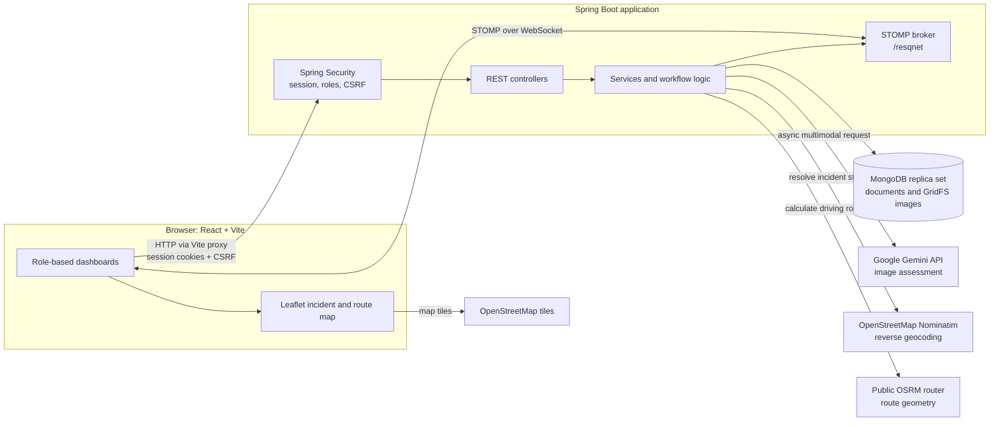

# ResQNet

ResQNet is a disaster-management application built to connect public incident reporting with command-center review and coordinated field response. People can submit a report with a photograph and location; administrators review it, emergency stations assign available resources, and field workers receive and operate dispatches. The project combines a Spring Boot backend, a React dashboard, MongoDB persistence, AI-assisted image assessment, geospatial queries, and real-time updates.

> **Scope:** ResQNet is a software project, not an emergency service. Its AI assessments, public routing/geocoding integrations, and simulated vehicle movement are not substitutes for verified emergency-response procedures.

## Problem and approach

During a disaster, reports can be incomplete, repeated, or difficult to route to the right response team. ResQNet implements a role-based workflow to collect photo-and-location reports, identify likely duplicates, assist review with image analysis, and move approved incidents through station and worker dispatch operations. Separate dashboards expose the relevant work to reporters, administrators, station managers, and field workers.

The system records workflow state and resource assignments in MongoDB. HTTP endpoints handle user actions, while STOMP over WebSocket delivers report, mission, and simulated-location updates to connected dashboards.

## Implemented features

- **Incident reporting:** authenticated users submit an image, coordinates, and a one-word alphabetic incident label; reports and image files are persisted separately using MongoDB and GridFS.
- **AI-assisted assessment:** the backend sends report images to Google Gemini for structured estimates of confidence, severity, disaster type, and response forces. Administrators remain responsible for review and approval.
- **Duplicate linking:** reports from the previous 24 hours are matched against nearby active or completed incidents within 500 metres when the trimmed report labels match without regard to case. A match links the new report to the existing incident and increments its report count.
- **Administrative review:** administrators receive assigned incidents, can edit assessment fields, and approve or reject reports. Assignment prefers available administrators with lower active-incident counts; unclaimed assignments are reconsidered after three minutes.
- **Station dispatch:** approval creates force-specific dispatches for nearby active stations. Station managers check available vehicles, personnel, and workers before assigning a worker and reserving resources.
- **Worker operations:** workers can start an assigned dispatch, follow its simulated route, report completion or a false alarm, and request backup or recall.
- **Backup and recall workflows:** station managers review backup and recall requests; approved backup requests create a separate dispatch, while approved recalls stop the simulation and restore the relevant station resources.
- **Map and live updates:** the user dashboard displays station locations and incident/vehicle locations on a Leaflet map. STOMP messages update report status, station missions, worker missions, and dispatch locations.
- **Authentication and CSRF protection:** form-based session login, BCrypt password hashing, role-restricted HTTP routes, and CSRF tokens are configured with Spring Security.

## Architecture



The Vite development server proxies the application paths and `/resqnet` WebSocket to the backend. The backend stores incident, user, station, resource, dispatch, backup, and recall records in MongoDB; uploaded image content is stored in GridFS. External map, geocoding, route, and AI services are not bundled with the application.

## End-to-end workflows

### Report, analyze, and review

1. A signed-in user submits an image, latitude, longitude, and a one-word alphabetic `userReport` label to `POST /disaster/report`.
2. The backend stores the image in GridFS and the report in MongoDB, then attempts reverse geocoding through OpenStreetMap Nominatim. If that lookup is unavailable, it tries to infer the state from the nearest stored station.
3. Before invoking the AI service, the backend searches recent, geographically nearby incidents. A matching report is linked to the existing incident and contributes to its report count; it does not start a second AI analysis.
4. For a non-duplicate, asynchronous Gemini analysis supplies structured confidence, severity, disaster-type, and force estimates. The backend calculates a final confidence value from the AI confidence, reporter trust score, and report count; low values mark the incident as suspicious.
5. An administrator receives an incident for review and can edit the generated fields before approving or rejecting it. Failed AI runs are retried by scheduled processing; after five recorded failures the incident is marked for manual review.

### Review, station assignment, and field response

1. Approval marks the incident `VERIFIED` and derives a baseline vehicle/personnel request from severity, adjusted by the final-confidence multiplier.
2. For each required force, ResQNet searches active matching stations near the incident, excluding stations previously rejected for that incident. The closest candidate receives a dispatch; if no eligible station is available for a force, the incident is flagged with `DISPATCH_FAILED`.
3. A station manager approves or rejects the mission. Approval checks station resources and worker availability, reserves the assigned resources, assigns a worker, and changes the dispatch to `DISPATCH_ASSIGNED`. Rejection records that station as rejected and attempts to route the mission to another eligible station.
4. The assigned worker starts the dispatch. ResQNet requests driving-route geometry from the public OSRM router, stores the route, and advances a simulated vehicle along it. A worker can report completion or a false alarm after the simulation reaches the destination.
5. A station manager confirms completion or a false alarm. Confirmed completion releases the station resources; the incident becomes `COMPLETED` after its dispatches and backups are no longer active. A confirmed false alarm cancels the dispatch and updates the incident only when no other active dispatch remains.

### Backup and recall

- A worker may request backup for an arrived, active dispatch. The station manager reviews the requested vehicles and personnel; approval reserves those resources and creates a separate backup dispatch so the original mission can continue.
- A worker may request recall for an arrived, dispatched unit. The station manager can approve or reject the request. Approval atomically claims the pending recall, restores the dispatch's resources, marks the dispatch `RECALLED`, stops its simulation, and notifies the worker and dashboards. A rejected recall leaves the mission running.

### Principal incident and dispatch states

The implementation keeps incident, assignment, AI, backup, and recall state in separate enums. A typical incident path is:

```text
REPORTED -> AI_PROGRESS -> UNDER_REVIEW -> VERIFIED
         -> DISPATCH_ASSIGNED -> DISPATCHED
         -> DISPATCH_COMPLETED -> COMPLETED
```

Other implemented states include `ALREADY_PRESENT`, `REJECTED`, `DISPATCH_FAILED`, `DISPATCH_FALSE`, `DISPATCH_CANCELLED`, `BACKUP_REQUEST`, `BACKUP_ASSIGNED`, `BACKUP_DISPATCHED`, `BACKUP_DISPATCH_COMPLETED`, and `RECALLED`. These are not all interchangeable steps in one linear state machine; several represent per-dispatch or exceptional outcomes.

## Technology stack

| Area | Technologies and versions in project files |
| --- | --- |
| Backend | Java 25; Spring Boot 4.1.1; Spring AI 2.0.0; Maven Wrapper 3.3.4 using Maven 3.9.16 |
| Persistence | MongoDB with Spring Data MongoDB; MongoDB GridFS for uploaded image content |
| Backend integrations | Spring MVC, Spring Security, Spring WebSocket/STOMP, Spring WebFlux `WebClient`, Jakarta Validation, Lombok 1.18.48 |
| Frontend | React `^18.3.1`, React DOM `^18.3.1`, React Router `^6.26.2` (lockfile: 6.30.6), Vite `^5.4.8` (lockfile: 5.4.21) |
| Mapping and messaging | Leaflet `^1.9.4`, `@stomp/stompjs` `^7.5.0` |
| UI icons | `lucide-react` 0.441.0 |

The versions above come from `pom.xml`, `frontend/package.json`, `frontend/package-lock.json`, and the Maven wrapper properties. Frontend entries show the manifest's semver ranges and, where different, the lockfile's resolved version; they are not claims about deployed infrastructure.

### External services

| Service | Use in ResQNet |
| --- | --- |
| Google Gemini (`gemini-3-flash-preview`) | Image-based incident assessment through Spring AI; requires a Google GenAI API key. |
| OpenStreetMap Nominatim | Reverse geocoding incident coordinates to a state or locality. |
| Public OSRM router (`router.project-osrm.org`) | Driving-route geometry used by the dispatch simulation. |
| OpenStreetMap tile service | Map tiles displayed by the browser dashboard. |

These services are called over the network and are not local dependencies or guaranteed-availability components.

## Engineering highlights

- **MongoDB geospatial data:** incident and station coordinates use GeoJSON points with `2dsphere` indexes. Duplicate detection uses a 500-metre geospatial query; station selection filters by active status and force before distance ordering.
- **Document and file separation:** report metadata is stored as a MongoDB document, while image bytes are stored through GridFS and fetched by image ID.
- **Role-aware workflows:** Spring Security enforces `USER`, `ADMIN`, `STATION_MANAGER`, and `WORKER` route access. Browser requests use session cookies and the CSRF token cookie/header flow.
- **Asynchronous work and scheduled recovery:** AI assessment and station matching use async services. Scheduled jobs retry AI failures, escalate exhausted retries to manual review, and reassign timed-out administrator reviews.
- **Route simulation:** OSRM route responses are validated for coordinate ranges, point count, and proximity to the assigned station and incident. A per-dispatch scheduled task advances the route every two seconds, persists progress, and sends location updates. Active simulations are checked for recovery when the application starts.
- **Concurrency safeguards:** station, resource, and recall documents use Spring Data MongoDB version fields. Recall approval/rejection uses a conditional MongoDB update from `PENDING` to a terminal decision so competing approvals cannot restore the same resources twice.
- **Transactions and error handling:** the application configures a `MongoTransactionManager`; several multi-document workflows are transactional. Services explicitly handle route-provider failures, simulation scheduling failures, and selected state conflicts. No application-wide `@ControllerAdvice` or `@ExceptionHandler` was found in the inspected source.

The route movement is a **simulation**, not GPS telemetry from a real vehicle. Its tick interval is two seconds; its target duration is approximately 210 seconds for longer routes, subject to a minimum simulated speed.

## Repository structure

```text
ResQNet/
├── .mvn/wrapper/                 # Maven Wrapper configuration
├── mvnw, mvnw.cmd                # Unix and Windows Maven Wrapper launchers
├── pom.xml                       # Backend dependencies, Java and Spring versions
├── src/
│   ├── main/java/com/dev/ResQNet/
│   │   ├── *Controller.java      # REST endpoints and request handling
│   │   ├── *Service*.java        # Report, review, station, AI and dispatch workflows
│   │   ├── *Repo.java            # MongoDB repositories
│   │   ├── *Entity.java          # MongoDB documents
│   │   ├── *Dto.java             # API and WebSocket payloads
│   │   ├── *Config.java          # Security, WebSocket, async and scheduler setup
│   │   └── *Service.java         # Routing, geocoding and dispatch simulation
│   ├── main/resources/
│   │   ├── application*.properties
│   │   └── static/               # Vite build output served as Spring static assets
│   └── test/java/com/dev/ResQNet/
│       └── *Test.java            # Backend unit, MVC, workflow and integration tests
└── frontend/
    ├── package.json
    ├── vite.config.js
    └── src/
        ├── api/                  # Auth, REST and STOMP clients
        ├── components/           # Shared dashboard components
        ├── pages/                # User, admin, station, worker and auth pages
        └── styles/               # Global and page-level styles
```

## Local setup and execution

### Requirements

- Java 25 and the included Maven Wrapper.
- Node.js and npm compatible with the declared Vite 5 toolchain.
- MongoDB and `mongosh`, with a replica set named `rs0`. The configured Spring transaction manager requires a replica-set deployment for MongoDB transactions.
- A Google GenAI API key for the configured Gemini model.
- Network access to the configured Gemini, Nominatim, OSRM, and OpenStreetMap tile services for their respective features.

### Start MongoDB

For a local Windows development instance, create a data directory and start `mongod` with the replica-set name used by the application:

```powershell
New-Item -ItemType Directory -Force C:\data\db
mongod --dbpath C:\data\db --replSet rs0 --bind_ip localhost
```

In a second terminal, initialize the replica set once:

```powershell
mongosh --eval "rs.initiate()"
```

The development profile connects to `mongodb://localhost:27017/ResQNetdb?replicaSet=rs0`. If MongoDB is running elsewhere, update that URI in the local application configuration.

### Run the backend

From the repository root, set the required key in the same terminal that starts Spring Boot:

```powershell
$env:GEMINI_API_KEY = "<your Google GenAI API key>"
.\mvnw.cmd spring-boot:run
```

The configured development profile uses port `8080` by default. Do not put a real API key in the README, source control, or a committed properties file.

### Run the frontend

In a separate terminal:

```powershell
cd frontend
npm ci
npm run dev
```

Open `http://localhost:5173`. The Vite configuration proxies the backend paths and the `/resqnet` WebSocket to `http://localhost:8080`. The frontend does not declare a separate API-base environment variable.

`npm run build` writes the production frontend bundle to `src/main/resources/static` (the Vite `outDir`); it is not needed for the Vite development-server workflow.

### Provisioning roles and station data

Public registration creates accounts with the `USER` role only. Admin, station-manager, and worker dashboards require corresponding role assignments and MongoDB records for stations and resources. No database seeding or privileged-account provisioning script is included, so those records must be provisioned separately before exercising the complete response workflow.

## Configuration and environment

| Setting | Source | Purpose |
| --- | --- | --- |
| `spring.profiles.active=dev` | `src/main/resources/application.properties` | Selects the development profile by default. |
| `spring.mongodb.uri` | `application-dev.properties` | MongoDB connection; defaults to local database `ResQNetdb` on replica set `rs0`. |
| `GEMINI_API_KEY` | Environment variable referenced by `application-dev.properties` | Google GenAI API key used by Spring AI. No key is included in the repository. |
| `spring.ai.google.genai.chat.model` | `application-dev.properties` | Configured model: `gemini-3-flash-preview`. |
| External service URLs | Backend source | Nominatim and OSRM public endpoints are currently specified in code; OpenStreetMap tiles are loaded by the frontend. They are not configurable through documented environment variables. |
| Frontend API origin | `frontend/vite.config.js` | Relative paths are proxied to the local backend at port `8080`; Vite serves the UI on port `5173`. |

`application-prod.properties` is present but contains no production-specific settings. The repository does not include a production deployment configuration.

## HTTP API overview

The API uses session-based authentication rather than bearer-token authentication. `USER`, `ADMIN`, `STATION_MANAGER`, and `WORKER` below refer to the roles enforced by Spring Security. All paths are relative to the backend origin.

| Role | Method and path | Request / purpose |
| --- | --- | --- |
| Public | `GET /public/csrf` | Initialize the CSRF cookie for the browser client. |
| Public | `POST /public/register` | JSON account registration (`email`, `username`, `password`); new accounts receive `USER`. |
| Public | `POST /user/login` | Form URL-encoded `username` and `password`; establishes a session. |
| Authenticated | `POST /logout` | Ends the session; include the CSRF header. |
| Authenticated | `GET /user/me` | Current user's ID, username, and roles. |
| Authenticated | `GET /user/stations` | Station coordinates and display data for the map. |
| `USER` | `POST /disaster/report` | Multipart form fields: `image`, `latitude`, `longitude`, and alphabetic single-word `userReport`. |
| `USER` | `GET /disaster/my-reports` | Reports submitted by the authenticated user. |
| `USER`, `ADMIN` | `PATCH /disaster/{disasterId}/update` | JSON update of report fields. |
| `ADMIN` | `GET /admin/disasters` | Assigned incidents and administrator statistics. |
| `ADMIN` | `PATCH /admin/{disasterId}/update` | JSON update of incident assessment fields. |
| `ADMIN` | `PATCH /admin/{disasterId}/approve` | Optional JSON assessment overrides; approve and initiate station assignment. |
| `ADMIN` | `POST /admin/{disasterId}/reject` | Reject an incident report. |
| `ADMIN` | `GET /fetch/image/{imageId}` | Retrieve an uploaded image from GridFS. |
| `STATION_MANAGER` | `GET /station/missions` | Station missions and statistics. |
| `STATION_MANAGER` | `/station/{dispatchId}/approve`, `/reject`, `/complete`, `/fake` | Dispatch decision or confirmation. Controllers accept `GET`, `POST`, and `PATCH`; the frontend uses `PATCH`. |
| `STATION_MANAGER` | `GET /station/recall/pending` | Pending recall requests for the manager's station. |
| `STATION_MANAGER` | `/station/recall/{recallId}/approve`, `/reject` | Decide a recall request. Controllers accept `GET`, `POST`, and `PATCH`; the frontend uses `PATCH`. |
| `WORKER` | `GET /dispatch/assigned` | Assigned dispatches and backup requests. |
| `WORKER` | `POST /dispatch/start/{dispatchId}` | Start an assigned dispatch simulation. |
| `WORKER` | `POST /dispatch/backup/{dispatchId}/request` | JSON request with `reqVehicles` and `reqPersonnel`; allowed after arrival on an active dispatch. |
| `WORKER` | `PATCH /dispatch/complete/{dispatchId}`, `PATCH /dispatch/false/{dispatchId}` | Report completion or a false alarm after arrival. |
| `WORKER` | `POST /dispatch/recall/{dispatchId}` | Optional JSON body with a `reason`; request recall of an arrived dispatched unit. |
| `WORKER` | `GET /dispatch/recall/active` | Recall requests submitted by the current worker. |

`GET /disaster/csrf` is also implemented. State-changing browser requests use the CSRF cookie/header configured by Spring Security.

## Real-time communication

- **STOMP endpoint:** `/resqnet` (WebSocket). The simple broker is enabled for `/topic`, `/queue`, `/update`, and `/new`; user-specific destinations use the `/user` prefix.
- **Subscriptions are role-gated** by the WebSocket security configuration: report queues for `USER`, disaster topics for `ADMIN`, mission updates for `STATION_MANAGER`, and mission/location messages for `WORKER`.

| User destination subscribed by frontend | Typical message flow |
| --- | --- |
| `/user/queue/report` | Reporter receives report, AI, review, and completion status messages. |
| `/user/queue/dispatch-location` | Reporters receive simulated dispatch coordinates and arrival/status updates for linked reports. |
| `/user/topic/disaster` | Administrators receive review assignments and incident/dispatch status notifications. |
| `/user/update/mission` | Station managers receive dispatch, backup, and recall updates. |
| `/user/new/mission` | Workers receive assignments and recall decisions. |
| `/user/new/location` | A worker receives simulated route progress and arrival notification. |

The admin UI also listens to broadcast `/topic/disaster`, and the station UI listens to broadcast `/update/mission`, alongside their user-specific subscriptions. The user and worker location/status flows use their `/user/...` destinations. Location updates are produced by the simulation service; they do not represent a live vehicle GPS feed.

## Tests and verification

Backend tests are under `src/test/java/com/dev/ResQNet`. They cover registration and authenticated endpoints, duplicate detection, admin updates, station/worker dispatch workflows, backup and recall decisions (including concurrency cases), route parsing and simulation behavior, image retrieval, and an authenticated STOMP user-destination integration test.

Run the backend suite from the repository root after setting up MongoDB and `GEMINI_API_KEY`:

```powershell
.\mvnw.cmd test
```

The frontend `package.json` defines `dev`, `build`, and `preview` scripts; it does not define a frontend test script. No test or build execution result is claimed in this README.

## Current limitations and possible next steps

**Verified limitations**

- The development profile is the only populated application profile. Production configuration and deployment instructions are not supplied.
- Public Nominatim and OSRM endpoints are hard-coded; AI assessment also depends on the configured external Gemini service and API key.
- Registration provisions only public `USER` accounts. The repository contains no seed script for privileged roles, stations, or station resources.
- The UI's moving vehicle is a backend-driven route simulation, not a live positioning integration.
- No centralized application-wide exception-advice class was found in the inspected backend source.

**Possible future improvements (not currently implemented)**

- Add repeatable development fixtures for stations, resources, and role-specific accounts.
- Make geocoding and routing providers configurable and provide local test doubles for offline development.
- Add production profile/deployment configuration and operational monitoring appropriate to the intended environment.
- Add automated frontend tests for the reporting and role-specific dashboard workflows.

## Resume-ready project summary

- Built a multi-role disaster-management application with Spring Boot, MongoDB, session-based authorization, and React dashboards for reporters, administrators, station managers, and field workers.
- Implemented image-backed incident reporting with GridFS, geospatial duplicate detection, and asynchronous Gemini-assisted assessment with scheduled retry and manual-review handling.
- Developed station/resource-aware dispatch, backup, recall, completion, and false-alarm workflows, including MongoDB concurrency safeguards for recall decisions.
- Integrated OSRM route geometry with scheduled vehicle-route simulation and STOMP/WebSocket updates rendered on a Leaflet map.
