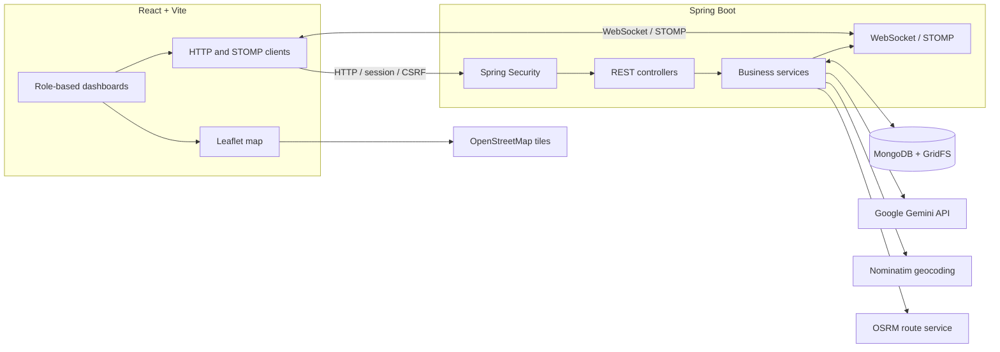

# ResQNet — AI-Assisted Disaster Management & Emergency Response

ResQNet is a role-based disaster-management application that connects public incident reporting with administrative review, emergency-station coordination, and field-worker dispatch operations.

Built with **Java, Spring Boot, MongoDB, React, and Spring AI**, the system combines image-assisted incident assessment, geospatial queries, resource allocation, route-based vehicle simulation, and real-time communication to model an end-to-end emergency-response workflow.

> **Project scope:** ResQNet is a software project, not an emergency service. AI assessments, public routing and geocoding services, and simulated vehicle movement are not substitutes for verified emergency-response procedures.

## Overview

Disaster-response coordination involves more than collecting incident reports. Reports may be incomplete or duplicated, incidents require review, stations have limited resources, and response teams need clear assignment and status updates.

ResQNet implements a workflow connecting these activities through role-specific dashboards and a Spring Boot backend. MongoDB stores application state, while HTTP APIs handle user actions and STOMP over WebSocket supports real-time dashboard updates.

### Key features

- **Incident reporting:** Submit incident photographs, geographic coordinates, and a short incident label.
- **AI-assisted assessment:** Use Google Gemini through Spring AI to estimate incident confidence, severity, disaster type, and required response forces.
- **Duplicate detection:** Identify matching reports within a geographic and time window, link them to existing incidents, and update report counts.
- **Administrative review:** Review AI-assisted assessments and approve or reject incidents.
- **Geospatial station assignment:** Find nearby active stations matching the required response force.
- **Resource management:** Check vehicle, personnel, and worker availability before assigning a mission.
- **Dispatch lifecycle:** Assign missions to field workers and track their status through a route-based simulation.
- **Backup and recall:** Support station-manager review of backup and recall requests.
- **Real-time updates:** Deliver report, mission, status, and simulated-location updates through WebSocket/STOMP.
- **Role-based access control:** Separate the responsibilities of users, administrators, station managers, and workers.

## User roles

| Role | Responsibilities |
|---|---|
| `USER` | Submit incident reports and view report status and related dispatch updates. |
| `ADMIN` | Review incident assessments, manage review decisions, and monitor incident information. |
| `STATION_MANAGER` | Review station missions, allocate resources, and confirm mission completion or false alarms. |
| `WORKER` | Operate assigned dispatches, follow simulated routes, and submit backup or recall requests. |

Spring Security enforces role-restricted HTTP access. The application uses session-based authentication rather than bearer-token authentication.

## Architecture



The frontend provides separate dashboards for each role. The backend owns workflow logic, authorization, persistence, assignment decisions, and simulation state. External services provide AI-assisted image assessment, reverse geocoding, route geometry, and map tiles.

MongoDB stores application documents, while GridFS stores uploaded image content. The Vite development server proxies backend HTTP paths and the `/resqnet` WebSocket endpoint.

## End-to-end workflows

### 1. Incident reporting and AI-assisted assessment

1. An authenticated user submits an incident photograph, latitude, longitude, and a one-word alphabetic `userReport` label through `POST /disaster/report`.
2. The backend stores the image in GridFS and the incident document in MongoDB.
3. The backend attempts reverse geocoding through OpenStreetMap Nominatim to resolve the incident's state or locality. If the lookup is unavailable, it attempts to infer the state from the nearest stored station.
4. Duplicate detection checks recent incidents against the configured time and geographic constraints. A matching report links to the existing incident and updates its report count instead of initiating another AI assessment.
5. For a non-duplicate report, asynchronous Gemini analysis produces structured estimates of confidence, severity, disaster type, and response forces.
6. The backend calculates a final confidence value using AI confidence, reporter trust, and report count. Low-confidence reports can be flagged as suspicious.
7. Administrators review the incident and can edit the assessment before approving or rejecting it.

AI processing failures are handled by scheduled retry logic. After the configured retry limit is exhausted, the incident is marked for manual review.

### 2. Administrative review and station assignment

1. An administrator reviews an incident and approves or rejects it.
2. Approval marks the incident `VERIFIED` and derives a baseline vehicle and personnel requirement from severity, adjusted using final confidence.
3. For each required response force, the backend searches for nearby active stations that support that force and have not previously been rejected for the incident.
4. The closest eligible station is selected. If no eligible station is available for a required force, the incident is flagged with `DISPATCH_FAILED`.
5. The station manager reviews the mission and either approves or rejects it.
6. Approval checks resource and worker availability, reserves the required resources, assigns a worker, and transitions the dispatch to `DISPATCH_ASSIGNED`.
7. Rejection records the station as rejected for that incident and allows the assignment process to try another eligible station.

### 3. Worker dispatch and route simulation

1. A worker receives an assigned dispatch and starts the mission.
2. The backend requests driving-route geometry from the public OSRM routing service.
3. The route is validated, stored, and advanced by a scheduled simulation task.
4. The simulation persists dispatch-location progress and sends updates to connected dashboards.
5. Worker actions such as completion, false-alarm reporting, backup requests, and recall requests follow the configured dispatch lifecycle and authorization checks.
6. A station manager confirms completion or a false alarm before the corresponding downstream workflow is finalized.

**Vehicle movement is simulated.** ResQNet does not claim to receive real GPS telemetry from emergency vehicles.

### 4. Backup and recall

**Backup requests**

- A worker can request backup for an eligible active dispatch after arrival.
- The station manager reviews the requested vehicles and personnel.
- An approved backup request reserves resources and creates a separate backup dispatch.
- The original mission continues independently of the backup dispatch.

**Recall requests**

- A worker can request recall for an eligible dispatched unit after arrival.
- The station manager can approve or reject the request.
- An approved recall claims the pending request, restores the relevant station resources, marks the dispatch `RECALLED`, stops its simulation, and notifies the relevant dashboards.
- A rejected recall leaves the mission running.

These workflows use separate dispatch and request records where applicable. Their exact transitions are defined by the application's status enums and service logic.

## State management

ResQNet keeps incident, AI, assignment, dispatch, backup, and recall states separate. A simplified incident lifecycle is:

```text
REPORTED
   |
   v
AI_PROGRESS
   |
   v
UNDER_REVIEW
   |
   +----> REJECTED
   |
   v
VERIFIED
   |
   v
DISPATCH ASSIGNMENT
   |
   v
DISPATCHED
   |
   +----> DISPATCH_FALSE / DISPATCH_CANCELLED
   |
   v
DISPATCH_COMPLETED
   |
   v
COMPLETED
```

The diagram is illustrative rather than a complete state machine. Actual transitions depend on the workflow and may be represented by separate per-dispatch states.

Other implemented states include `ALREADY_PRESENT`, `DISPATCH_FAILED`, `DISPATCH_ASSIGNED`, `DISPATCH_FALSE`, `DISPATCH_CANCELLED`, `BACKUP_REQUEST`, `BACKUP_ASSIGNED`, `BACKUP_DISPATCHED`, `BACKUP_DISPATCH_COMPLETED`, and `RECALLED`.

## Technology stack

| Area | Technology |
|---|---|
| Language | Java 25 |
| Backend framework | Spring Boot 4.1.1 |
| AI integration | Spring AI 2.0.0 and Google Gemini |
| Persistence | MongoDB and Spring Data MongoDB |
| File storage | MongoDB GridFS |
| Security | Spring Security, session authentication, BCrypt, CSRF |
| HTTP APIs | Spring MVC |
| Real-time communication | Spring WebSocket and STOMP |
| HTTP client | Spring WebFlux `WebClient` |
| Frontend | React 18, React DOM 18, React Router 6 |
| Frontend tooling | Vite 5 and npm |
| Interactive maps | Leaflet and OpenStreetMap tiles |
| Route geometry | Public OSRM routing service |
| Reverse geocoding | OpenStreetMap Nominatim |
| Backend build | Maven Wrapper |

The listed backend versions come from the uploaded README's project-file inspection. Frontend dependencies use the declared manifest ranges, with resolved versions recorded in the lockfile. They describe the project configuration, not a deployed production environment.

## Engineering highlights

### Geospatial queries

Incident and station coordinates use GeoJSON points with MongoDB `2dsphere` indexes. Geospatial queries support nearby-incident duplicate detection and station selection based on location, force compatibility, and station status.

### Document and image persistence

Incident metadata is stored in MongoDB documents, while uploaded image bytes are stored in GridFS. Image retrieval uses the stored image identifier, keeping image content separate from the main incident document.

### Role-aware access and workflow boundaries

Spring Security restricts HTTP endpoints by role. User, administrator, station-manager, and worker actions are handled by distinct controllers and services, allowing the backend to validate ownership, availability, and allowed state transitions.

### Asynchronous processing and recovery

AI assessment and station matching use asynchronous services. Scheduled jobs retry failed AI processing and reconsider timed-out administrator reviews. Active dispatch simulations are also checked for recovery when the application starts.

### Route-based simulation

The backend obtains route geometry from OSRM, validates route coordinates, and advances a simulated vehicle using scheduled tasks. Location progress is persisted and sent to connected dashboards at a two-second simulation tick.

The target duration is approximately 210 seconds for longer routes, subject to the configured minimum simulated speed and actual route length.

### Concurrency safeguards

Spring Data MongoDB version fields and conditional updates protect selected concurrent workflows. Recall decisions use a conditional transition from `PENDING` to a terminal decision so competing decisions cannot independently restore the same resources.

### Transactions and failure handling

The application configures a `MongoTransactionManager`, and selected multi-document workflows use transactions. Route-provider failures, simulation scheduling failures, and selected state conflicts have explicit handling.

These engineering details describe the implementation; they do not imply that every possible failure mode has been tested or that the application is production-hardened.

## Repository structure

```text
ResQNet/
├── .mvn/
│   └── wrapper/                 # Maven Wrapper configuration
├── mvnw
├── mvnw.cmd
├── pom.xml                      # Backend dependencies and build settings
├── src/
│   ├── main/
│   │   ├── java/com/dev/ResQNet/
│   │   │   ├── *Controller.java # HTTP endpoints
│   │   │   ├── *Service*.java   # Workflow and business logic
│   │   │   ├── *Repo.java       # MongoDB repositories
│   │   │   ├── *Entity.java     # Persistent domain documents
│   │   │   ├── *Dto.java        # API and messaging payloads
│   │   │   └── *Config.java     # Application configuration
│   │   └── resources/
│   │       ├── application*.properties
│   │       └── static/          # Frontend build output
│   └── test/java/com/dev/ResQNet/
│       └── *Test.java           # Backend tests
└── frontend/
    ├── package.json
    ├── package-lock.json
    ├── vite.config.js
    └── src/
        ├── api/                 # HTTP and STOMP clients
        ├── components/          # Shared UI components
        ├── pages/               # Role-specific dashboards
        └── styles/              # Frontend styling
```

## Local setup and execution

The commands below follow the Windows development workflow documented for this project. Adjust paths and connection settings for your environment.

### Prerequisites

- Java 25
- The included Maven Wrapper
- Node.js and npm compatible with the Vite toolchain
- MongoDB with replica-set support and `mongosh`
- A Google GenAI API key for the configured Gemini integration
- Network access to the external AI, geocoding, routing, and map-tile services

### 1. Start MongoDB

For a local Windows development instance, create a data directory and start MongoDB with the replica-set name used by the application:

```powershell
New-Item -ItemType Directory -Force C:\data\db
mongod --dbpath C:\data\db --replSet rs0 --bind_ip localhost
```

In another terminal, initialize the replica set once:

```powershell
mongosh --eval "rs.initiate()"
```

The development profile uses:

```text
mongodb://localhost:27017/ResQNetdb?replicaSet=rs0
```

MongoDB transactions require a replica-set-capable deployment. If MongoDB runs elsewhere, update the local connection configuration accordingly.

### 2. Configure the Gemini API key

In the same PowerShell terminal used to launch the backend:

```powershell
$env:GEMINI_API_KEY = "<your Google GenAI API key>"
```

Do not commit real API keys to source control or place them in public documentation.

### 3. Start the backend

From the repository root:

```powershell
.\mvnw.cmd spring-boot:run
```

The development configuration uses port `8080` by default.

### 4. Start the frontend

Open a second terminal:

```powershell
cd frontend
npm ci
npm run dev
```

Open:

```text
http://localhost:5173
```

The Vite development server proxies backend HTTP paths and the `/resqnet` WebSocket connection to the backend.

### 5. Build the frontend

From the `frontend` directory:

```powershell
npm run build
```

The configured Vite output directory is `src/main/resources/static`. A frontend build is not required when running the separate Vite development server.

### Provisioning application roles and data

Public registration creates accounts with the `USER` role. Administrator, station-manager, and worker workflows require appropriately provisioned roles and the corresponding station and resource records.

The documented repository does not include a complete database seeding or privileged-account provisioning script. Provision those records separately before testing the complete incident-to-dispatch workflow.

## Configuration and external services

| Configuration | Purpose |
|---|---|
| `spring.profiles.active=dev` | Selects the development profile by default. |
| `spring.mongodb.uri` | Configures the MongoDB connection in the development profile. |
| `GEMINI_API_KEY` | Supplies credentials for the Google GenAI integration. |
| `spring.ai.google.genai.chat.model` | Selects the configured Gemini model, `gemini-3-flash-preview`. |
| Backend service URLs | Nominatim and OSRM endpoints are specified in backend source. |
| Vite proxy configuration | Routes frontend API and WebSocket requests to the local backend. |

External integrations:

| Service | Purpose |
|---|---|
| Google Gemini | AI-assisted image-based incident assessment |
| OpenStreetMap Nominatim | Reverse geocoding incident coordinates |
| Public OSRM router | Driving-route geometry for dispatch simulation |
| OpenStreetMap tile service | Map tiles in the frontend |

These services are accessed over the network and are not bundled with ResQNet. Their availability, usage limits, response times, and terms are outside the application's control.

The repository contains an `application-prod.properties` file, but the documented inspection did not identify production-specific settings. A production deployment configuration should not be assumed to exist.

## HTTP API overview

The backend uses session-based authentication. The following table summarizes the routes documented in the project's controllers; all paths are relative to the backend origin.

| Role | Method and endpoint | Purpose |
|---|---|---|
| Public | `GET /public/csrf` | Initialize the browser CSRF cookie. |
| Public | `POST /public/register` | Register an account with `USER` role. |
| Public | `POST /user/login` | Form-based login and session establishment. |
| Authenticated | `POST /logout` | End the session; CSRF protection applies. |
| Authenticated | `GET /user/me` | Retrieve current-user identity and roles. |
| Authenticated | `GET /user/stations` | Retrieve station display data for the map. |
| `USER` | `POST /disaster/report` | Submit an image-based incident report. |
| `USER` | `GET /disaster/my-reports` | Retrieve the current user's reports. |
| `USER`, `ADMIN` | `PATCH /disaster/{disasterId}/update` | Update supported report fields. |
| `ADMIN` | `GET /admin/disasters` | Retrieve assigned incidents and statistics. |
| `ADMIN` | `PATCH /admin/{disasterId}/update` | Update assessment fields. |
| `ADMIN` | `PATCH /admin/{disasterId}/approve` | Approve an incident and initiate station assignment. |
| `ADMIN` | `POST /admin/{disasterId}/reject` | Reject an incident report. |
| `ADMIN` | `GET /fetch/image/{imageId}` | Retrieve an uploaded GridFS image. |
| `STATION_MANAGER` | `GET /station/missions` | Retrieve station missions and statistics. |
| `STATION_MANAGER` | `/station/{dispatchId}/approve`, `/reject`, `/complete`, `/fake` | Review dispatches and confirm outcomes. |
| `STATION_MANAGER` | `GET /station/recall/pending` | Retrieve pending station recall requests. |
| `STATION_MANAGER` | `/station/recall/{recallId}/approve`, `/reject` | Decide recall requests. |
| `WORKER` | `GET /dispatch/assigned` | Retrieve assigned dispatches and backup requests. |
| `WORKER` | `POST /dispatch/start/{dispatchId}` | Start a dispatch simulation. |
| `WORKER` | `POST /dispatch/backup/{dispatchId}/request` | Request backup with `reqVehicles` and `reqPersonnel`. |
| `WORKER` | `PATCH /dispatch/complete/{dispatchId}` | Report dispatch completion. |
| `WORKER` | `PATCH /dispatch/false/{dispatchId}` | Report a suspected false alarm. |
| `WORKER` | `POST /dispatch/recall/{dispatchId}` | Request recall, optionally with a reason. |
| `WORKER` | `GET /dispatch/recall/active` | Retrieve the current worker's recall requests. |

The station decision and recall decision routes support the HTTP methods configured by their controllers; the frontend uses `PATCH`. Consult the controller implementations for exact request and response schemas before integrating another client.

State-changing browser requests use the CSRF cookie/header flow configured by Spring Security.

## Real-time communication

ResQNet uses **STOMP over WebSocket** with the `/resqnet` endpoint and a simple broker configured for `/topic`, `/queue`, `/update`, and `/new`. User-specific destinations use the `/user` prefix.

| Frontend subscription | Intended message flow |
|---|---|
| `/user/queue/report` | Reporter receives report, AI, review, and completion updates. |
| `/user/queue/dispatch-location` | Reporter receives simulated dispatch coordinates and arrival/status updates for linked incidents. |
| `/user/topic/disaster` | Administrator receives review assignments and incident/dispatch notifications. |
| `/user/update/mission` | Station manager receives mission, backup, and recall updates. |
| `/user/new/mission` | Worker receives mission assignments and recall decisions. |
| `/user/new/location` | Worker receives simulated route progress and arrival notifications. |

The administrator and station dashboards also subscribe to broadcast destinations where configured. The exact subscriptions and role authorization rules are defined by the WebSocket configuration and frontend STOMP clients.

**Real-time caveat:** The messaging architecture is implemented in code, but this README does not claim that every live delivery scenario has been manually verified.

## Testing and verification

Backend tests reside under:

```text
src/test/java/com/dev/ResQNet/
```

The uploaded project documentation identifies tests covering areas such as:

- Registration and authenticated endpoints
- Duplicate detection and administrator updates
- Station and worker dispatch workflows
- Backup and recall decisions, including concurrency cases
- Route parsing and simulation behavior
- Image retrieval
- Authenticated STOMP user-destination integration

Run the backend suite from the repository root after configuring the required environment:

```powershell
.\mvnw.cmd test
```

The frontend manifest defines `dev`, `build`, and `preview` scripts. It does not define a frontend test script in the documented configuration.

Test coverage and successful execution should be reported only from actual test results. The presence of tests does not by itself establish that every integration or live WebSocket scenario works in a running environment.

## Current limitations and future improvements

Potential next steps, subject to project priorities:

- Add deployment-specific configuration, secret management, and operational monitoring.
- Evaluate performance and concurrency behavior under realistic workloads.
- Replace simulated vehicle movement with a verified telemetry integration if a suitable real-world integration becomes available.

---

**ResQNet** — Connecting incident reports, administrative decisions, station resources, and simulated field response in one workflow.
